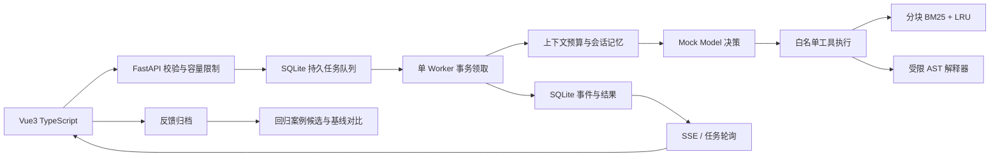

# 架构与设计决策

## 应用分层

项目包含三个独立业务入口，共用 FastAPI 生命周期：

| 模块                                | 模型执行                                                    | 数据与恢复                                              |
| ----------------------------------- | ----------------------------------------------------------- | ------------------------------------------------------- |
| 运营助手 `/api/game`                | 真实兼容 Chat Completions API；普通 RAG 或一次 Tool Calling | PostgreSQL 权威数据、Redis 缓存与租约；过期生成标记失败 |
| 工程工作台 `/api/chat`、`/api/runs` | 确定性 Mock，支持 react / plan / multi                      | SQLite 任务队列；重启从任务起点执行                     |
| `/api/runtime-demo`                 | 独立 MockModel 的模型—工具循环                              | SQLite 检查点；审批、幂等写入、逐步恢复                 |

## 运营助手数据流

前端提交会话 ID、请求 ID 和当前问题，后端验证会话归属，从 PostgreSQL / Redis 读取已完成历史。普通模式通过 LangChain Retriever 与 LCEL 链执行 BM25 检索；Tool Calling 模式先请求真实模型生成一个 `search_knowledge` 调用，再经 StructuredTool 校验与执行。检索片段通过 PromptTemplate 组织为证据，连同历史送入真实模型，HTTP/SSE 网关将文本增量返回前端。

回答与来源提交 PostgreSQL 成功后发送 `done`。Redis 提供带知识版本的检索缓存、会话上下文缓存和生成租约；数据库再检查运行状态与请求 ID。Redis 缓存可降级回源，生成锁不可降级。LangChain 不接管模型 HTTP 连接、会话持久化或取消生命周期。

模型请求在异步 HTTP 链路执行，数据库操作在线程池运行。文档和历史作为不可信数据进入提示词；工具仅允许知识检索并严格验证参数。提示词约束不等同于生产授权系统。完整预算、超时和迁移语义见 [运营助手文档](GAME-OPS.md)。

## 工程工作台数据流

## 工程工作台关键决策

1. **领域边界**：模型只产生动作计划；工具和存储不依赖具体模型供应商。Mock 决策可重复，利于测试，不能代表真实模型智能。
2. **协议边界**：Python Pydantic 负责运行时校验；Vue TypeScript 负责编译期类型。旧 shared SSE 类型与 Python 保持兼容；集成测试验证实际 SSE 终止和结果。
3. **持久化**：SQLite WAL 支持读写并行；写事务尽量短。任务领取使用 BEGIN IMMEDIATE 避免两个领取操作选中同一条记录；当前进程内 worker 串行执行。
4. **重启语义**：启动时 running → queued，重新执行整个任务。事件保留并继续编号。这个策略只能用于单 worker，不能当作带租约的分布式队列。记忆写入通过主键去重；未来外部副作用必须增加幂等设计。
5. **取消语义**：客户端中断 SSE 会将非终态 run 标记 cancelled；工具步骤之间检查状态。已执行工具不会回滚。后台 run 不随浏览器断开而取消。失败重试产生新的 run，关闭测试故障。
6. **容量控制**：待执行/运行队列上限 32，SSE 上限 8，worker 任务超时 30 秒，SSE 总等待 90 秒。HTTP 请求体按实际读取字节限制 220KB；同步本地工具耗时很短，但不能直接套用于阻塞外部工具。
7. **上下文**：保留当前请求，再分配最多 800 字符长期记忆，剩余空间保留最近连续历史。历史超预算时丢弃更旧消息。默认 12000 字符、最大 32000；检索块最多 360 字符、最多 5 块，是独立证据预算。
8. **检索**：英文词与中文双字切分 → 重叠窗口分块（360 长度，280 步长）→ BM25 评分 → top_k。缓存最多 128 查询，写入文档清空缓存。不是 Embedding。
9. **可观测性**：每个 run 对应 trace，seq 单调递增，记录工具输入/输出与时间，不伪造隐藏思维链。`/api/metrics` 提供 Prometheus 文本计数。当前事件包含本地任务内容，生产必须设置保留期、脱敏和访问控制。

## 安全边界

AST 解释器只支持数字、单目正负号和加减乘除取余；无 eval/exec，无导入、函数调用、属性、文件、网络。限制表达式长度、AST 节点数和数值大小。它是有限 DSL 执行器，不是任意代码隔离容器。

文档和工具输出在前端以 Vue 文本插值渲染，不使用 v-html，不把导入内容作为系统指令。工程工作台 Mock 不存在真实提示注入推理链路；运营助手已接入 LLM，仍须将文档标记为不可信证据，验证工具参数并对写操作授权。

默认监听 loopback，无 CORS 放开。没有用户身份系统、CSRF token、审计脱敏和多租户行级访问控制，所以不能直接暴露公网。

## 扩展路线

- 模型：运营助手已有兼容 HTTP 网关；工程工作台和 Runtime 可扩展独立供应商适配器，结构化动作校验、重试退避、超时、真实 tokenizer、费用预算；密钥只读取后端环境，禁止 VITE_ 前缀。
- 分布式：API 与 worker 分离；PostgreSQL 管理任务状态，Redis Streams 或 RabbitMQ 管理传输；显式 ACK、超时租约、心跳、重投递和死信。每个外部副作用以 run_id + step_id 幂等。
- RAG：异步文档解析、版本化索引、向量召回与 RRF 融合、重排；用标注数据计算 recall@k、MRR、引用忠实度。
- 追踪：将本地事件映射成 OpenTelemetry spans，传播 traceparent，统一采样、脱敏、日志和告警。
- 沙箱：独立容器运行用户代码，非 root、只读根文件系统、无默认网络、CPU/内存/PID/时间限制，任务后销毁。

## 工程工作台故障演练

工具异常：在实验室打开故障注入，预期 failed + error 事件，前端显示重试入口。预算不足：multi + 计算问题设置 max_steps=1，预期失败而非无限循环。崩溃恢复：提交后台任务后终止服务，重启观察恢复；对应自动化测试已模拟 running 记录恢复。高并发：运行负载脚本，超过容量时应产生可观测的 429，而不是无界增长。
